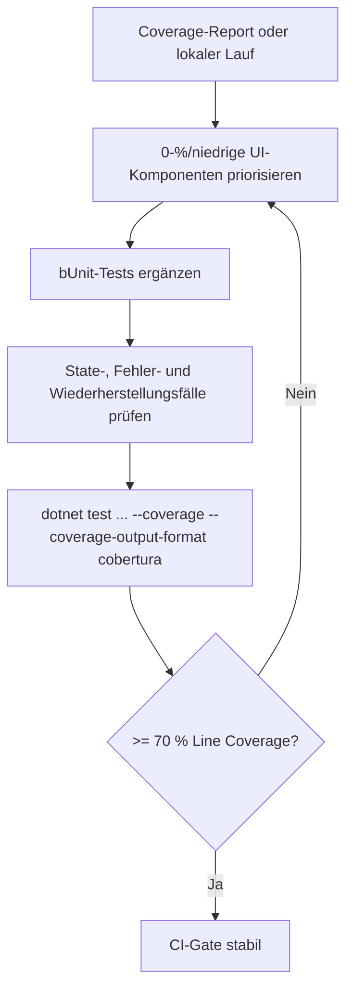
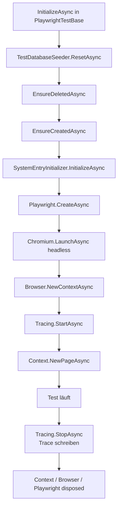

# Playwright-Tests — Technischer Ablauf

## Übersicht

Die Playwright-Tests starten die Anwendung als echten Kestrel-Server auf festen Ports (5099–5104), setzen vor jedem Test die Datenbank zurück und steuern dann einen Chromium-Browser über die Playwright .NET-API (headless unter `CI=true`, lokal sichtbar). Die Infrastruktur gliedert sich in `PlaywrightServer` (Kestrel-Host als Collection-Fixture), `PlaywrightApiFactory` (In-Process-`TestServer` für API-Aufrufe des Blazor-Servers — kein TCP-Self-Request), `PlaywrightTestBase` (Browser-Lebenszyklus und Tracing) und `TestDatabaseSeeder` (Datenbankrücksetzung).

## Coverage-Gate-Stabilisierung

Das konkrete Feature „Coverage Gate schlägt fehl“ wird in den bUnit-Komponententests umgesetzt. Der Ablauf dient weniger der Funktionslogik, sondern der Wiederholbarkeit des CI-Gates.

### 1. Coverage-Lücken identifizieren

Die Ausgangsbasis ist ein lokaler Lauf oder das CI-Artifact mit dem Line-Coverage-Report. Kandidaten sind Komponenten mit 0 % oder deutlich unter 70 % Abdeckung, etwa `ApplicationContentView`, `EnvironmentSelector`, `AppShell` und `MainLayout`.

Beteiligte Komponenten:
- `dotnet test --solution Schnittstellenzentrale.slnx -- --filter "Category!=OsInterface" --coverage --coverage-output-format cobertura` — führt die lokale Coverage-Erfassung der regulären Lane aus.
- `TestMockFactory.CreateCoverageScenarioDependencies` — liefert wiederverwendbare Mocks und Testdaten für kritische Zustände.

### 2. Fehler- und State-Pfade absichern

Für jede betroffene UI-Komponente wird ein kompakter bUnit-Test ergänzt:

- `ApplicationContentViewTests` prüft OData-/Swagger-Importfehler, Erfolgs- und Wiederholungszustände.
- `EnvironmentSelectorTests` prüft leere Listen, gelöschte Auswahl und `localStorage`-Sauberkeit.
- `AppShellTests` prüft Initialisierungsreihenfolge und unvollständige Storage-Zustände.
- `MainLayoutTests` prüft Moduswechsel, Wiederherstellung der aktiven Umgebung und `localStorage`-Recovery.

### 3. Coverage-Lauf wiederholen

Der relevante Nachweis ist der wiederholte lokale Lauf:

```bash
dotnet test --solution Schnittstellenzentrale.slnx -- --filter "Category!=OsInterface" --coverage --coverage-output-format cobertura
```

Erst wenn die Line-Coverage der regulären Lane die feste 70-%-Schwelle überschreitet, gilt das Feature als abgeschlossen. Ein zusätzliches E2E-Setup bleibt optional und dient nur dann dem Ziel, wenn die UI-Abdeckung durch bUnit-Tests allein nicht ausreicht.



---

## Ablauf: Testserver-Start (einmalig pro Collection)

xUnit instanziiert `PlaywrightServer` einmalig als `ICollectionFixture<PlaywrightServer>` beim Start der Collection `"Playwright"` — die übrigen Collections nutzen die Unterklassen `PlaywrightSignalRServer`, `PlaywrightImpressumServer`, `PlaywrightImpressumLanguageServer`, `PlaywrightImpressumFallbackServer` und `PlaywrightODataEndpointServer` mit gestaffelten Ports 5100–5104.

### 1. `InitializeAsync`

`PlaywrightServer.InitializeAsync` baut und startet die Anwendung über `Program.BuildWebApplicationAsync` in markierten Phasen; Fehler werden mit Phase, `BindUrl` und letztem Fehler erneut geworfen, damit ein Startfehler im TRX diagnostizierbar bleibt statt erst beim ersten `Page.GotoAsync` als Timeout aufzutreten:

- `Anchor-DB` — legt eine benannte Shared-Cache-In-Memory-SQLite (`Data Source={guid};Mode=Memory;Cache=Shared`) an und hält sie per geöffneter Anker-Verbindung am Leben; kein Datei-Locking zwischen Testläufen. Außerdem wird die `PlaywrightApiFactory` mit ihrem In-Process-Handler erzeugt.
- `BuildWebApplicationAsync` — baut die App mit Umgebung `Playwright` (lädt `appsettings.Playwright.json`), dem Content-Root des Webprojekts und den Service-Overrides aus Schritt 2.
- `StartAsync` — `_app.Urls` wird auf die feste `BindUrl` gesetzt (Port 5099 bzw. Unterklassen-Ports), Kestrel bindet.
- `WaitForServerReady` — pollt den echten Kestrel-Socket (500-ms-Intervall, 60-s-Deadline); **jede** HTTP-Antwort gilt als „ready", auch 404/Redirects; der Poll umgeht bewusst den System-Proxy.
- `OnAfterStartAsync` — Unterklassen-Hook (z. B. SignalR-Proxy-Verdrahtung).
- `Swagger-Warmup` — lädt `/swagger/v1/swagger.json` einmal über die API-Factory vor (Swashbuckle-Erstaufruf ist spürbar langsam).

### 2. Service-Overrides und `ConfigureTestServices`

Beteiligte Komponenten: `TestAuthHandler`, `AppDbContext`, `ISignalRNotificationService`, `ICurrentUserService`, `PlaywrightApiFactory`, `SignalRNotificationProxy`

- Entfernt alle vorhandenen Authentication-Registrierungen (`IAuthenticationSchemeProvider`, `IAuthenticationHandlerProvider`, `IConfigureOptions<AuthenticationOptions>`).
- Registriert `TestAuthHandler` als einziges Auth-Schema `"Test"`.
- Ersetzt `IDbContextFactory<AppDbContext>` durch eine SQLite-Verbindung auf die benannte In-Memory-DB; jeder Server öffnet eine eigene Verbindung (ein geteiltes Verbindungsobjekt würde bei gleichzeitigem Zugriff zu SQLite-Fehlern führen).
- Entfernt alle `IHostedService`-Registrierungen (z. B. `SystemEndpointSyncService`), damit Hintergrunddienste während der Tests nicht laufen.
- Ersetzt `ISignalRNotificationService` durch `SignalRNotificationProxy`, das zunächst ins Leere (No-Op) delegiert.
- Ersetzt `ICurrentUserService` durch ein `Moq`-Mock-Objekt, das konstant `TEST\testuser` zurückgibt.
- `ISwaggerImportService` wird gemockt — der HTTP-Fetch von `swagger.json` hängt im Playwright-Environment; das Parsing selbst testet `SwaggerImportServiceTests`.
- `UploadSettings.MaxIconSizeBytes` wird auf 512 KB gesetzt (Standardwert; `appsettings.json` konfiguriert 5 MB).
- `ImpressumSettings.FilePath` zeigt auf einen garantiert nicht vorhandenen Pfad, damit `ImpressumService.IsAvailable()` `false` liefert und der Sidebar-Link ausgeblendet bleibt.
- API-Aufrufe (`ApplicationApiClient` u. a.) laufen über den In-Process-Handler der `PlaywrightApiFactory` (`PostConfigureAll<HttpClientFactoryOptions>`) — der Blazor-Server macht damit keinen TCP-Request gegen sich selbst.
- Am Ende ruft der Build-Callback das überschreibbare `ConfigureTestServices(IServiceCollection)` der Unterklasse auf.

### 3. `DisposeAsync`

`PlaywrightServer.DisposeAsync` ist komplett best-effort: `_app.StopAsync()`/`DisposeAsync()`, `_apiFactory.Dispose()` und die Anker-Verbindung laufen einzeln mit Fehlersammlung nach `Console.Error` — die Methode wirft nie, damit ein Cleanup-Fehler den eigentlichen Assert nicht überdeckt.

---

## Ablauf: Test-Setup und Teardown (pro Testklasse)

`PlaywrightTestBase` implementiert `IAsyncLifetime`. Die Testklassen erben von `PlaywrightTestBase`; `SitePageTests` implementiert `IAsyncLifetime` direkt (keine Server-Fixture — `site/` wird per Route-Interception ausgeliefert).

### 1. `InitializeAsync`

Beteiligte Komponenten: `TestDatabaseSeeder`, `IPlaywright`, `IBrowser`, `IBrowserContext`, `IPage`

1. `TestDatabaseSeeder.ResetAsync` wird aufgerufen (Schema zurücksetzen und Systemeinträge seeden, siehe unten).
2. `_server.BaseAddress` wird in `BaseUrl` gespeichert.
3. `Microsoft.Playwright.Playwright.CreateAsync()` erzeugt eine `IPlaywright`-Instanz.
4. `_playwright.Chromium.LaunchAsync(new BrowserTypeLaunchOptions { Headless = TestPaths.IsHeadless() })` startet Chromium — headless nur unter `CI=true`, lokal mit sichtbarem Fenster.
5. `_browser.NewContextAsync()` erzeugt einen `IBrowserContext` (Locale `de-DE`, `Accept-Language`-Header); `SetDefaultTimeout(30 s)` und `SetDefaultNavigationTimeout(60 s)` setzen explizite Budgets.
6. `Context.Tracing.StartAsync(new TracingStartOptions { Screenshots = true, Snapshots = true, Sources = true })` aktiviert die Aufzeichnung.
7. `Context.NewPageAsync()` erzeugt die `IPage`-Instanz, die dem Test als `Page`-Property zur Verfügung steht; `OnInitializedAsync()` ist der Unterklassen-Hook für zusätzliche Kontexte.

### 2. Testmethode

Der Test navigiert via `Page.GotoAsync(BaseUrl)` zur Startseite und interagiert mit der UI.

### 3. `DisposeAsync`

1. `Directory.CreateDirectory(TraceDirectory)` stellt sicher, dass das Ausgabeverzeichnis existiert — absolut verankert am Repo-Root (`TestPaths.FindRepoRoot()`), nicht relativ zum Testhost-Arbeitsverzeichnis.
2. `Context.Tracing.StopAsync(new TracingStopOptions { Path = "playwright-traces/{TestName}-HHmmssfff.zip" })` schreibt die Trace-Datei (UTC-Zeitstempel-Suffix, damit mehrere Tests derselben Klasse einander nicht überschreiben), mit 30-s-Budget und best-effort-Fehlersammlung.
3. `Context.DisposeAsync()`, `_browser.DisposeAsync()`, `_playwright.Dispose()` geben alle Playwright-Ressourcen frei — jeweils einzeln best-effort, Fehler werden nur protokolliert.

---

## Ablauf: Datenbankrücksetzung (`TestDatabaseSeeder.ResetAsync`)

Beteiligte Komponenten: `TestDatabaseSeeder`, `IDbContextFactory<AppDbContext>`, `AppDbContext`, `SystemEntryInitializer`

1. Ein neuer DI-Scope wird über `_services.CreateScope()` erzeugt.
2. `IDbContextFactory<AppDbContext>.CreateDbContext()` erzeugt einen `AppDbContext` auf der benannten In-Memory-DB.
3. `db.Database.EnsureDeletedAsync()` löscht das bestehende Schema.
4. `db.Database.EnsureCreatedAsync()` legt das Schema neu an.
5. `SystemEntryInitializer.InitializeAsync(_services, _configuration)` legt die Systemgruppe und -anwendung neu an.
6. `SeedSystemEndpointsAsync()` registriert den System-Endpunkt `POST /authenticate` — im Playwright-Environment ist `SystemEndpointSyncService` als `IHostedService` entfernt.



---

## Ablauf: SignalR-Echtzeitsynchronisation (`SignalRSyncTests`)

Beteiligte Komponenten: `SignalRSyncTests`, `PlaywrightSignalRServer`, `EndpointHub`, `SignalRNotificationService<EndpointHub>`, `SignalRNotificationProxy`

`PlaywrightSignalRServer` erbt von `PlaywrightServer` (BindUrl `http://127.0.0.1:5100`) und aktiviert den echten SignalR-Stack:

- `ConfigureTestServices` ersetzt die `SignalRNotificationProxy`-Registrierung durch die echte `SignalRNotificationService<EndpointHub>`.
- `OnAfterStartAsync` verdrahtet zusätzlich den `ApiNotificationProxy` der `PlaywrightApiFactory` auf eine echte `SignalRNotificationService<EndpointHub>`-Instanz über den `IHubContext<EndpointHub>` des Kestrel-Servers — damit Notifications aus API-Controller-Aufrufen die verbundenen Browser erreichen.

`SignalRSyncTests` erbt wie die anderen Testklassen von `PlaywrightTestBase` und ergänzt über die Unterklassen-Hooks einen zweiten Browser-Kontext:

1. `OnInitializedAsync` legt `_contextB` über `CreateAdditionalContextAsync()` an (gleicher `IBrowser`, eigenes Tracing, gleiche Default-Timeouts) und öffnet `_pageB`.
2. Beide Seiten navigieren zur Startseite und wechseln per `Locator(".sz-topbar-select").SelectOptionAsync("Team")` in den Team-Modus.
3. Browser A legt über das UI eine neue Anwendung an (Button „+ Neue Anwendung", Felder „Name" und „Basis-URL", Button „Speichern").
4. `Assertions.Expect(_pageB.Locator(".sz-tree-item-btn", new() { HasText = "SignalR-Sync-Test" })).ToBeVisibleAsync()` wartet, bis der neue Eintrag in Browser B erscheint — ohne `Page.ReloadAsync`.
5. `OnDisposingAsync` stoppt das Tracing von Kontext B best-effort (`StopTraceBestEffortAsync`, 30-s-Budget) und dispost den Kontext.

Beide Kontexte schreiben separate Trace-Dateien: `SignalRSyncTests-HHmmssfff.zip` (Hauptkontext A über die Basisklasse) und `SignalRSyncTests-B-HHmmssfff.zip` (Zusatzkontext B über `StopTraceBestEffortAsync`).

---

## Klassenübersicht

| Klasse | Namespace | Zweck |
|---|---|---|
| `PlaywrightServer` | `Schnittstellenzentrale.Tests.Playwright.Infrastructure` | Kestrel-Testserver auf festem Port 5099; Auth-Bypass, benannte In-Memory-SQLite, Service-Overrides |
| `PlaywrightSignalRServer` | `Schnittstellenzentrale.Tests.Playwright.Infrastructure` | Erbt von `PlaywrightServer` (Port 5100); aktiviert echten SignalR-Stack |
| `PlaywrightImpressumServer` u. a. | `Schnittstellenzentrale.Tests.Playwright.Infrastructure` | Weitere `PlaywrightServer`-Unterklassen (Impressum, Impressum-Fallback/-Language, OData-Endpunkt) auf Ports 5101–5104 |
| `PlaywrightApiFactory` | `Schnittstellenzentrale.Tests.Playwright.Infrastructure` | `WebApplicationFactory<Program>` mit `TestServer` — In-Process-Handler für API-Aufrufe des Blazor-Servers |
| `SignalRNotificationProxy` | `Schnittstellenzentrale.Tests.Playwright.Infrastructure` | Leitet Notifications an einen austauschbaren Inner-Service weiter (No-Op → echter Hub-Kontext) |
| `PlaywrightTestBase` | `Schnittstellenzentrale.Tests.Playwright.Infrastructure` | Basisklasse; verwaltet Playwright-Lebenszyklus und Tracing |
| `TestDatabaseSeeder` | `Schnittstellenzentrale.Tests.Playwright.Infrastructure` | Setzt die In-Memory-DB zurück; seedet Systemeinträge und Showcase-Daten |
| `TestPaths` | `Schnittstellenzentrale.Tests.Playwright.Infrastructure` | `FindRepoRoot()`/`IsHeadless()` — Repo-Root-Anker (`playwright-traces/`, `site/`) und Headless-Steuerung |
| `PlaywrightCollection` | `Schnittstellenzentrale.Tests.Playwright.Infrastructure` | `[CollectionDefinition("Playwright")]` mit `ICollectionFixture<PlaywrightServer>` |
| `PlaywrightSignalRCollection` | `Schnittstellenzentrale.Tests.Playwright.Infrastructure` | `[CollectionDefinition("PlaywrightSignalR")]` mit `ICollectionFixture<PlaywrightSignalRServer>` |
| `HomePageTests` | `Schnittstellenzentrale.Tests.Playwright` | Ablauf 1: Startseite und Systemeinträge |
| `ApplicationCrudTests` | `Schnittstellenzentrale.Tests.Playwright` | Ablauf 2: Anwendung anlegen, bearbeiten, löschen |
| `EndpointExecutionTests` | `Schnittstellenzentrale.Tests.Playwright` | Ablauf 3: Endpunkt ausführen |
| `SwaggerImportTests` | `Schnittstellenzentrale.Tests.Playwright` | Ablauf 4: Swagger-Import |
| `HealthCheckTests` | `Schnittstellenzentrale.Tests.Playwright` | Ablauf 5: Health-Check |
| `StorageModeTests` | `Schnittstellenzentrale.Tests.Playwright` | Ablauf 6: Speichermodus wechseln |
| `SignalRSyncTests` | `Schnittstellenzentrale.Tests.Playwright` | Ablauf 7: SignalR-Echtzeitsynchronisation |

---

## Fehlerbehandlung

- Schlägt ein Test fehl, enthält die Trace-Datei unter `playwright-traces/{TestName}-HHmmssfff.zip` (Repo-Root) Screenshots, DOM-Snapshots und Quelltexte zum Zeitpunkt des Fehlers.
- Bei `SignalRSyncTests` gibt es zwei Trace-Dateien: `SignalRSyncTests-HHmmssfff.zip` (Browser A) und `SignalRSyncTests-B-HHmmssfff.zip` (Browser B).
- Playwright-Assertions (`Assertions.Expect(...)`) warten standardmäßig bis zu 30 Sekunden auf das Erscheinen eines Elements, bevor sie fehlschlagen. Dieser Timeout greift auch bei SignalR-Updates in Browser B.
