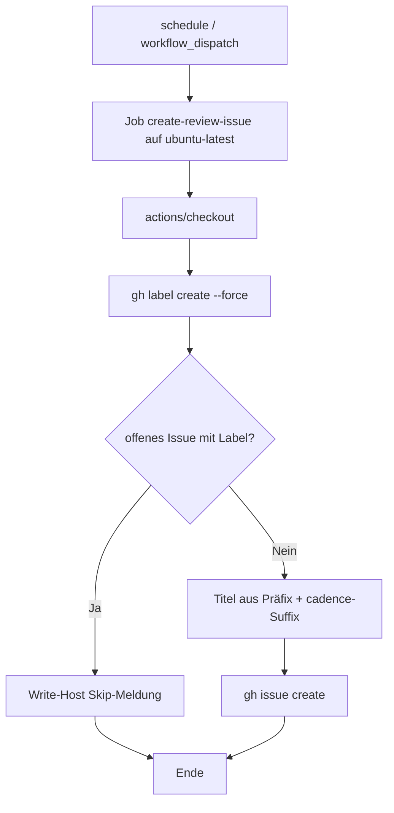

# Automatisierte Review-Workflows — Technischer Ablauf

## Übersicht

Drei Workflow-Dateien unter `.github/workflows/` werden per `schedule` (Cron, UTC) oder `workflow_dispatch` gestartet. Jeder Workflow besteht aus einem einzigen Job `create-review-issue` auf `ubuntu-latest`, der nach `actions/checkout@v7` die gemeinsame Composite Action `./.github/actions/create-review-issue` aufruft. Die Action stellt das Label sicher, prüft auf offene Duplikate und legt nur dann ein neues Issue an.

## Ablauf

### 1. Trigger und Job-Start

Auslöser ist der Cron-Zeitplan (`on.schedule`) oder die manuelle Auslösung (`workflow_dispatch`). Der Job `create-review-issue` läuft auf `ubuntu-latest` mit `timeout-minutes: 5`.

Cron-Zeitpunkte (UTC):

| Workflow | Cron | Zeitpunkt |
|----------|------|-----------|
| `monthly-architecture-security-review.yml` | `0 5 1 * *` | 1. des Monats, 05:00 |
| `weekly-nuget-review.yml` | `0 6 * * 1` | Montag, 06:00 (zwei Stunden nach `security-scan.yml`) |
| `yearly-compliance-review.yml` | `0 5 1 1 *` | 1. Januar, 05:00 |

Beteiligte Komponenten:

- `actions/checkout@v7` — zwingend erforderlich, damit `uses: ./.github/actions/create-review-issue` die Action-Datei im Workspace findet.
- `concurrency` — statische Gruppe pro Workflow (z. B. `weekly-nuget-review`) mit `cancel-in-progress: false`; serialisiert Läufe, damit zwei parallele Auslöser (z. B. `schedule` + `workflow_dispatch`) nicht beide „kein offenes Issue" sehen und doppelt anlegen.
- `permissions` — expliziter Block auf Workflow-Ebene: `contents: read` (für den Checkout) und `issues: write` (für `gh label create`, `gh issue list` und `gh issue create`). Kein `pull-requests: write`, da keine PRs erzeugt werden.

### 2. Composite Action `create-review-issue`

Die Action (`.github/actions/create-review-issue/action.yml`) nimmt sechs Pflicht-Inputs entgegen: `label`, `label-color`, `label-description`, `issue-title-prefix`, `issue-body` und `cadence` (`monthly` / `weekly` / `yearly`). Beide Schritte laufen mit `shell: pwsh` und setzen `GH_TOKEN: ${{ github.token }}` als `env` auf Step-Ebene, damit die `gh`-CLI sich gegen das Repository authentifiziert.

**Schritt „Ensure label exists":**

```
gh label create "<label>" --color "<hex>" --description "<text>" --force
```

`--force` macht den Aufruf idempotent: Das Label wird angelegt oder bei vorhandenem Label Farbe/Beschreibung aktualisiert. Anschließend wird `$LASTEXITCODE` geprüft und bei Fehler mit `exit $LASTEXITCODE` abgebrochen.

**Schritt „Create issue if none open":**

1. `gh issue list --label "<label>" --state open --json number | ConvertFrom-Json` liefert die offenen Issues mit dem Label; erneute `$LASTEXITCODE`-Prüfung.
2. `@($existing).Count -eq 0` zählt das Ergebnis robust (auch bei `null` oder Einzelobjekt). Nur bei leerem Ergebnis wird ein Issue angelegt — ein `gh`-Fehlschlag läuft so nicht still in den Create-Pfad.
3. Der Issue-Titel wird aus `issue-title-prefix` plus Perioden-Suffix gebildet. Das Suffix wählt ein `switch` auf `cadence`:
   - `monthly` → `Get-Date -Format 'yyyy-MM'`
   - `weekly` → `'{0}-KW{1:D2}'` aus `[System.Globalization.ISOWeek]::GetYear($now)` und `[System.Globalization.ISOWeek]::GetWeekOfYear($now)`. `GetYear` ist zwingend erforderlich, da die ISO-Kalenderwoche an Jahresgrenzen zum Folgejahr gehören kann (z. B. gehört der 29.12.2025 zu KW01/2026).
   - `yearly` → `Get-Date -Format 'yyyy'`
   - `default` → `throw` bei unbekanntem `cadence`-Wert.
4. `gh issue create --title "<titel>" --body $env:ISSUE_BODY --label "<label>"` legt das Issue an. Der Body wird über die `env`-Variable `ISSUE_BODY` übergeben — nicht über String-Interpolation —, um Quoting-/Encoding-Probleme der mehrzeiligen deutschen Texte zu vermeiden. Danach erneut `$LASTEXITCODE`-Prüfung.
5. Existiert bereits ein offenes Issue, wird nur `Write-Host` mit der Nummer des bestehenden Issues ausgegeben (Skip-Pfad, Exit-Code 0, kein Workflow-Fehlschlag).

Beteiligte Komponenten:

- `gh label create --force` — idempotente Label-Sicherstellung (Muster aus `sync-staging-with-main.yml`).
- `gh issue list --state open --json number` — Duplikat-Prüfung über das `automated-*`-Label.
- `gh issue create` — Issue-Erzeugung mit Titel, Body (`$env:ISSUE_BODY`) und Label.

## Diagramm



## Fehlerbehandlung

- Nach jedem `gh`-Aufruf wird `$LASTEXITCODE` geprüft; bei Fehler bricht der Step mit `exit $LASTEXITCODE` ab und der Workflow-Lauf schlägt fehl.
- Unbekannte `cadence`-Werte führen zu einem `throw` im `switch`.
- Ein bereits offenes Issue ist kein Fehler: Der Skip-Pfad endet mit Exit-Code 0.

## Hinweise und Einschränkungen

- **Aktivierung erst auf dem Default-Branch:** `schedule`- und `workflow_dispatch`-Trigger greifen erst, wenn die Workflow-Dateien auf `main` liegen; auf `staging` oder Feature-Branches allein feuern sie nicht.
- **Best-Effort-Zeitplan:** GitHub-`schedule`-Trigger sind nicht exakt — bei hoher Last können Läufe verzögert oder ausgelassen werden. In Repositories mit längerer Inaktivität deaktiviert GitHub geplante Workflows automatisch; sie müssen dann in der Actions-UI wieder aktiviert werden.
- **Benachrichtigung bei Fehlschlägen:** Bei fehlschlagenden `schedule`-Läufen benachrichtigt GitHub standardmäßig den Benutzer, der die Cron-Zeile zuletzt geändert hat. Ein separates Monitoring existiert nicht.
- **Erstlauf-Hinweis:** Die Duplikat-Erkennung basiert ausschließlich auf dem Label. Bereits vor Einführung der Workflows existierende, ungelabelte Review-Issues werden nicht erkannt — beim ersten Lauf kann daher ein Issue entstehen, obwohl thematisch bereits eines offen ist. Betroffene Alt-Issues müssten manuell mit dem jeweiligen `automated-*`-Label versehen oder geschlossen werden.
- **Cron-Angaben in UTC:** Alle Zeitpunkte sind UTC, nicht lokale Zeit (im Winter also z. B. 06:00 UTC = 07:00 MEZ).
